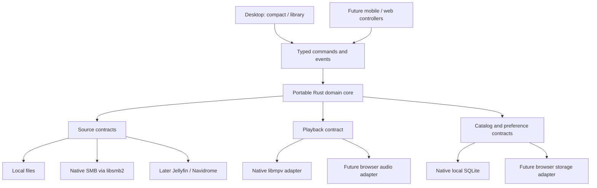

# Core and platforms target

## Architecture and boundaries

Use a local modular monolith in a monorepo. Rust owns portable player/domain
logic; platform adapters supply capabilities. Native clients embed their
engine. No central backend or ReSolibre identity service is required.

Each feature has one owning module, narrow typed API and authoritative state.
Share policy, validation and configuration across views/clients. Buttons, menus,
hotkeys and future remotes dispatch the same actions; shortcut mappings are
centralized, while OS registration remains an adapter. Test feature behavior once
at its owner and consumer wiring separately. These are project-wide rules, not
claims that hotkeys/remote control already exist.

Shared code may live outside `resolibre-core`: portable modules exclude native
libraries; reusable native crates wrap libmpv. Reuse existing implementations;
isolate only demonstrated OS/lifecycle/permission/build differences. Keep cohesive
modules and extract real reuse without speculative traits, crates or services.

Arrows describe dependency/use direction, not separate services. Native
libraries stay outside the portable core. Browser builds compile only
compatible modules; WebAssembly does not grant OS privileges.

## Ownership

| Owner | Responsibility |
| --- | --- |
| Portable core / shared modules | Session, queue/playlists, identities, processing policy, reusable DSP/analysis and later sync rules |
| Source adapters | Authentication, listing, bounded reads, seek capability, cancellation and source errors |
| Audio adapter | Decode/output lifecycle, actual position, buffering, format negotiation and processing |
| Storage adapter | Catalog queries, migrations, transactions, preferences and cache records |
| Desktop | Composition, shared controls, views, input drafts, focus and OS integration |

The core may own queue decisions while libmpv executes playback. Choose one
authoritative owner per state and reconcile engine events; do not maintain
independently advancing queues in UI and engine.

## Contracts and concurrency

Define typed operations for source registration, play/pause, absolute seek,
queue edits, search, layout preferences and EQ changes. Public interfaces
carry domain values, not arbitrary libmpv commands or native pointers.
Add typed app-volume/normalization/transition contracts as those slices begin.
Internal track IDs are stable and path-independent; source references remain
source/profile-scoped. Advanced cross-source matching is deferred.

Events include actual playback state/position, output format, buffering,
errors and catalog changes. Commands carry session/request generations where
stale completion could override newer intent. Queue edits use a revision;
future remotes receive a fresh snapshot after reconnect, then ordered events.

Bound channels and worker concurrency. Prioritize controls and audio over
scan/artwork work. Avoid unnecessary PCM copies and idle work. Never make UI or
audio callbacks wait for database/network
operations. Cancellation must reach source reads and pending searches where
the library allows it; otherwise discard stale results and bound their work.

## Runtime composition

Initial desktop runs one logical local player session. It opens no remote
control listener until that later feature is explicitly enabled. OS media
controls and tray/background behavior remain deliberate platform integrations.
The core cannot depend on a GUI event loop.

The Cargo workspace groups portable, native and Slint desktop crates.
The [core map](../core-project-map.md) routes implemented and future modules.
FFI wrappers isolate ownership/thread/lifetime contracts. The local session
implements bounded typed commands and one native owner; see the
[feature](../features/local-desktop-player.md) for limits, including blocking cleanup.

## Future platforms

- Windows now reuses shared native playback in the [x64 prototype](../../development/windows-native.md);
  retained-file, pipe, profile and window differences live in native adapters.
  Credentials and release qualification remain future work. Evaluate macOS later.
- Android/iOS need audio-session, interruption, background-playback and storage
  integration; a shared core does not remove these requirements.
- Web reuses portable behavior through WebAssembly where practical. Its
  decoder, output, source access and persistence must follow browser limits.
- Mobile/web UI frameworks and the exact exported binding ABI are open.
  Keep boundaries narrow now without generating unused client scaffolds.

See [open decisions](open-decisions.md) and
[test plan](../../testing/test-plan.md). A buildable portable-core test target
must be part of the first implementation, not an assumed future refactor.
