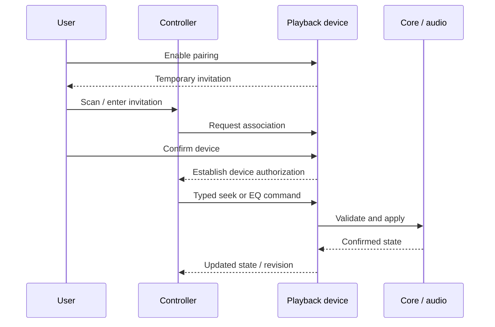

# Remote control target

## Timing and scope

Implement remote control when mobile or web development begins. Prepare typed
core commands/events now; do not ship an unused network listener in the first
desktop release. The first network scope is the same LAN, without mandatory
ReSolibre accounts or a central identity service. Internet connectivity is later.

The playback device owns music access, session, queue, output, app volume and EQ. A
controller sends authorized commands and displays confirmed state. A phone
changing the PC's EQ changes processing on the PC, not on the phone.
Source credentials remain with the playback device.

Controllers browse the target device's authorized library/playlists through
bounded queries and display its actual queue. A desktop track ID never becomes
a phone-local path. Pause/resume, skip, seek and volume target that session;
volume always follows the [application-only contract](audio-processing.md).

Remote control does not imply audio casting, handoff, file transfer, synchronized
multiroom playback or cloud libraries. Handoff/transfers have later scopes below;
multiroom remains outside this plan.

## Pairing experience and identity

Proposed experience:

1. The user enables pairing on the playback device.
2. It displays a short-lived, single-use invitation/QR.
3. The controller scans/enters it; the playback device confirms the association.
4. Each authorized device retains its own identity and protected credentials.
5. The user can inspect and revoke a single paired device.

Use established authenticated/encrypted transport and cryptographic libraries.
Do not design a custom cryptographic protocol, share one permanent master-key
file across devices, or treat LAN discovery as authorization. The concrete
protocol/credential format remains open until the implementation threat model.

## Commands and state

Expose a narrow versioned allowlist for playback, seek, queue, app volume, EQ
and authorized library/playlist queries.
Do not expose shell execution, arbitrary paths, raw libmpv commands, database
queries or general filesystem writes.

The playback device serializes state transitions. Use session IDs, revisions
and request IDs to reject stale commands and deduplicate retried mutations.
After reconnect, send an authoritative snapshot before incremental events.
Define backpressure, size/rate limits, timeouts and revocation propagation.

mDNS is an optional discovery mechanism, not the control protocol or authorization.
Evaluate WebSocket or another suitable transport for the same logical commands,
snapshots and events over direct reachable LAN and optional companion routing.
Keep domain handling shared; transport adapters must preserve authorization,
request identity and replay/stale rejection. No transport is selected yet.

This is a product flow, not a cryptographic handshake specification.

## Native versus browser

Native clients may support LAN discovery with a manual-address fallback.
Discovery is optional and must not reveal source credentials.
A general browser cannot be assumed to provide native multicast discovery,
trust arbitrary self-signed certificates, or connect from HTTPS to insecure
LAN services. Decide secure transport, browser permission and deployment
strategy with real-browser evidence. Account-free LAN control remains the
goal; a particular browser connection mechanism is not yet selected.

Internet control needs a separate NAT/reachability, privacy and deployment
decision, potentially involving user-managed networking or a relay. Do not
silently expose LAN ports publicly or add a mandatory account.

## Later handoff and explicit file transfers

Handoff transfers playback responsibility, unlike controlling another session.
Resolve the destination's available/authorized representation and position, or
use a separately permitted stream. Do not assume shared filenames or silently
replace versions. Define acknowledgement/failure behavior before stopping the
original session; unavailable destination audio must be reported honestly.

File transfer is opt-in and lower priority. Preview selected files/destinations,
check available storage and existing/duplicate candidates, bound work and verify
integrity. Recheck permissions and destination identity before finalizing; no
automatic deletion, overwrite or uncontrolled whole-library synchronization.
File-write authorization is separate from pairing for playback control.

## Optional companion and web clients

An optional self-hosted companion may host a web UI, playlist synchronization,
device registry/coordination, remote routing and persistent shared state. It
does not replace Jellyfin/Navidrome and is never required for their playback,
local use or directly reachable LAN control. Retain local ownership and define
state authority/conflict behavior before syncing; server loss cannot stop local
playback. Routing must not silently grant the relay access to music credentials
or broader device permissions. Deployment/trust details remain open.

Possible browser modes are a companion-served frontend, a locally served remote
UI or a later hosted frontend connecting to authorized services. Browser remote
control and browser-local playback have different capabilities. Local file access,
LAN discovery, cross-origin/secure transport, codecs, background audio and offline
storage require real-browser evidence; WebAssembly does not bypass restrictions.
Future cloud accounts, uploads and hosted synchronization are optional exploration,
not dependencies or commitments to operate a hosted service.

## Verification

Follow [security/privacy](security-and-privacy.md) and the
[test plan](../../testing/test-plan.md): unauthorized commands, invitation
expiry/reuse, revoked devices, replay, reconnect, stale sessions, concurrent
controllers and private-data disclosure. No remote runtime exists today.
