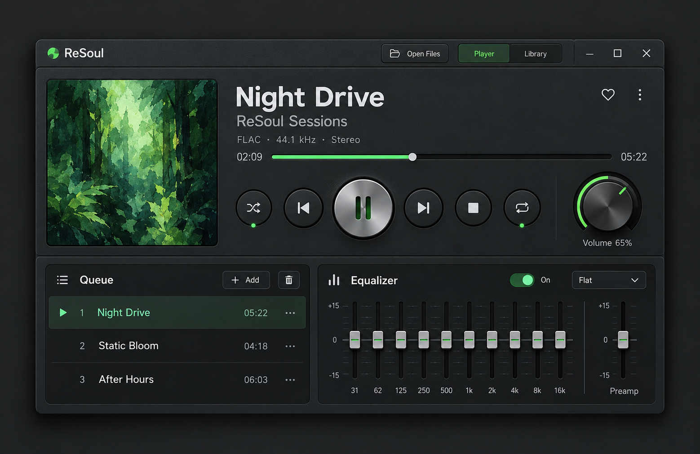

# Compact player design reference

Approved direction: 2026-10-22. Use the [saved concept](compact-player-reference.png)
as inspiration, not implementation evidence.

## Palette alternatives

User requested retaining both directions on 2026-10-22:

- **Green:** the original concept above, with restrained green accents.
- **Spectrum:** [new concept](compact-player-spectrum-reference.png), graphite with
  orange/coral, pink, violet and cyan/blue EQ groups and segmented volume markings.
  The main player retains green identity accents. EQ sits below the main player.

Both palettes now have a [built-in implementation](../architecture/features/player-appearance.md).
Concepts are not screenshots or DSP evidence. Colors never change audio.
Both original images are retained; [generation prompts](compact-player-spectrum-prompt.txt).

## Appearance

Skeuomorphic graphite chassis: fine edges, shallow sides and a brushed faceplate.
SHFL/REP/TRIM/FADE/EQ/LIB use equal 62 px illuminated keys, aligned left.
Play/Back/Next/Stop and volume sit below full-width seek. Track text has no frame. EQ tucks under the main case.
Center caps/glyphs for a frontal view; use smooth contours and subtle relief.
Use readable text, no focus rings and shared Lucide icons.
Use the compact reference for both palettes' density; Spectrum supplies colors,
not extra spacing. Native shading is allowed; focus/active colors stay solid.
A bundled [forest illustration](../../apps/desktop/ui/assets/forest-artwork.png)
is the fallback for missing embedded covers
([prompt/provenance](forest-artwork-prompt.txt)); its 206 px square uses cover fill.
One surface replaces the outer frame: mode/panel keys sit below transport, with
Themes/window controls above. Hosts share 6 px corners, layered bevels, native
drag/resize. Main has minimize/maximize/close; Close saves/stops. Library has
a thin draggable top inset, no title or close button; LIB hides it. A colored brush opens Themes; choices apply instantly. [Current compact view](player-compact.png).

## Independent surfaces

Both default visible: Library is a separate same-process window on the right;
EQ slides beneath the main case with a 6 px overlap, no rails or gap; one window.
**EQ** and **LIB** share a fine frame at the bottom right;
each hides/shows its surface. EQ uses a 300 ms cubic-bezier slide.

Main starts at 800×516 px with EQ, 800×264 px collapsed. Library starts
420×516 px. Hiding preserves queue, scroll, track, time and gain. EQ visibility never
changes audio bypass. Focus returns to the corresponding toggle. Theme/panel visibility persists. [Library ownership/snap](../architecture/features/detachable-playlist.md).

Initial docking and 5 px snap use X11/XWayland by default when available; native
Wayland lacks positioning. Main carries snapped peers; dragging Library detaches
it. Full library mode remains later.

## Provenance

Created with built-in image generation and approved in conversation: compact dark
radio, album-led transport, ten-band faders and green rotary volume; readable
matte graphite, no copied brands or decorative visualizers. The user subsequently
requested both palettes, then separate Library and a fixed EQ drawer.

[Interface target](../architecture/target/interface-and-themes.md),
[local implementation plan](../plans/local-desktop-player-plan.md).
